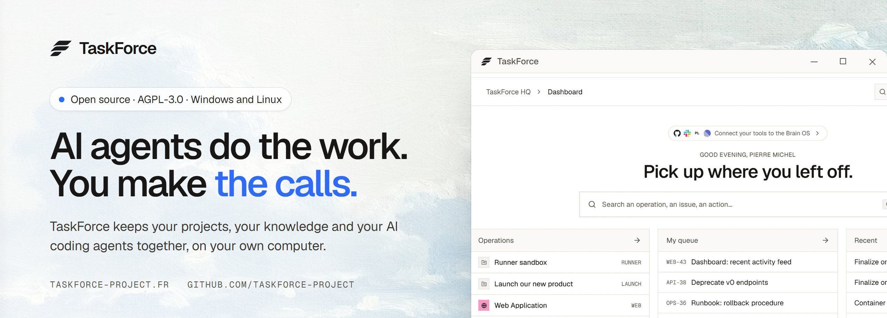
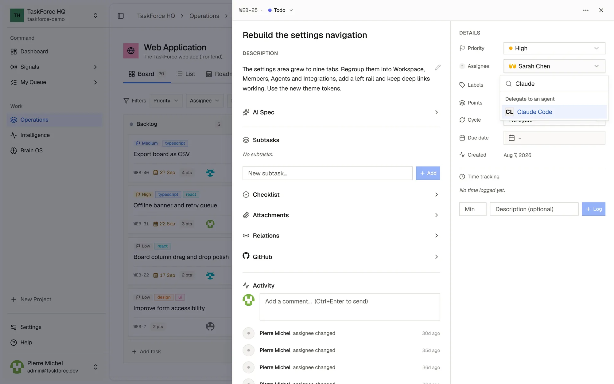
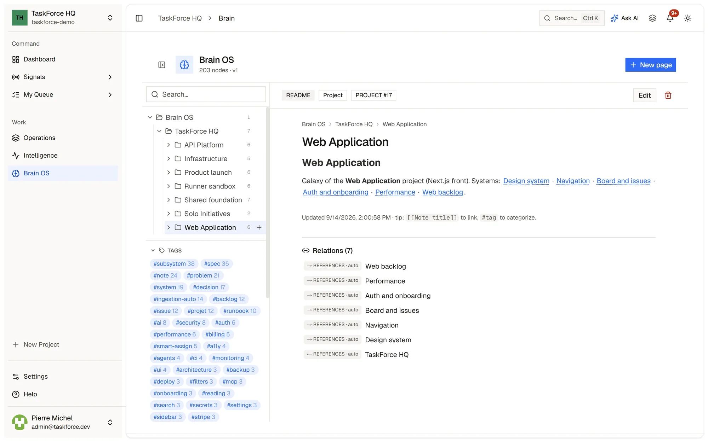

  

  <b>We build TaskForce, the open source desktop app for working with AI coding agents.</b> 
  Plan the work, keep the project's memory, hand tasks to Claude Code or GitHub Copilot, and review every result.

  <a href="https://taskforce-project.fr/download"><b>Download</b></a>
  &nbsp;·&nbsp;
  <a href="https://taskforce-project.fr"><b>Website</b></a>
  &nbsp;·&nbsp;
  <a href="https://docs.taskforce-project.fr"><b>Documentation</b></a>
  &nbsp;·&nbsp;
  <a href="https://github.com/taskforce-project/taskforce-fullstack"><b>Source code</b></a>

  
  
  

 

## What TaskForce does

Coding agents are fast, but working with them is still messy: context gets lost between tools, nobody sees what an
agent is doing, and its results land unchecked. TaskForce puts the plan, the project's memory and the agents in one
app, on your own computer, with you in charge.

<table>
  <tr>
    <td width="33%" valign="top">
      <b>Plan</b> 
      Board, list, backlog, cycles and roadmap over one set of issues, with analytics computed from the board itself.
    </td>
    <td width="33%" valign="top">
      <b>Remember</b> 
      Brain OS keeps specs, decisions and notes as linked Markdown pages, read by people and agents alike.
    </td>
    <td width="33%" valign="top">
      <b>Delegate</b> 
      Assign an issue to Claude Code or GitHub Copilot, follow the run live, answer when it asks, review the pull request.
    </td>
  </tr>
</table>

  

Delegating an issue to Claude Code, from the same menu you use to assign a teammate.

## How we build it

- **Local first.** Projects, Brain OS pages and files stay in a folder on the user's computer. Our server only keeps
  a free account, and the app sends no usage data.
- **People decide.** Agents work on their own branch, inside limits set by TaskForce. Anything risky waits for an
  answer, and nothing is merged without a person.
- **Open by default.** Every line is public under the AGPL-3.0 license, from the interface to the way agents are
  started. The design decisions are public too.
- **Engineered to last.** More than 1,800 backend tests and 1,100 frontend tests run in CI, and CodeQL, Semgrep and
  Trivy check every pull request. The desktop shell is tested before every build, and every installer is scanned by
  VirusTotal.

  

Brain OS, the project's memory: the decisions agents read before they start.

## Repositories

| Repository | What is inside |
| --- | --- |
| [**taskforce-fullstack**](https://github.com/taskforce-project/taskforce-fullstack) | The product. The desktop app for Windows and Linux, the self-hostable web app, the API, the runner for Claude Code, the website and the documentation site. AGPL-3.0. |
| [**taskforce-docs**](https://github.com/taskforce-project/taskforce-docs) | Brain OS, the engineering vault: architecture, 21 decision records, API contracts, security, runbooks and research. Notes in French. |
| **taskforce-motion** (private) | TaskForce Studio, the marketing and motion system: product captures, strategy, narrative and Remotion films. |

## Built with

| Part | Technology |
| --- | --- |
| Desktop app | Electron 44, with the API, the interface and PostgreSQL 18 running inside |
| API | Java 21, Spring Boot 4, PostgreSQL 18 with pgvector, Flyway |
| Interface | Next.js 16, React 19, TypeScript, Tailwind CSS |
| AI | Ollama on the computer, or any OpenAI-compatible API |
| Coding agents | Claude Code through a local runner, GitHub Copilot coding agent |
| Website and docs | Astro, Fern |

## Support the project

  

- **Star [taskforce-fullstack](https://github.com/taskforce-project/taskforce-fullstack).** It is the simplest way
  to support the project, and it helps other teams find it.
- **Watch its releases.** Click Watch, then Custom, then Releases, to hear about each new version.
- **Follow this organization** to see what comes next.
- **Try it on a real project**, then [tell us what you think](https://github.com/taskforce-project/taskforce-fullstack/issues).

  
  
  

---

  Built by <a href="https://github.com/Miche1-Pierre">Pierre Michel</a> · final project of a level 6 RNCP degree, Metz Numeric School · 2025-2026

